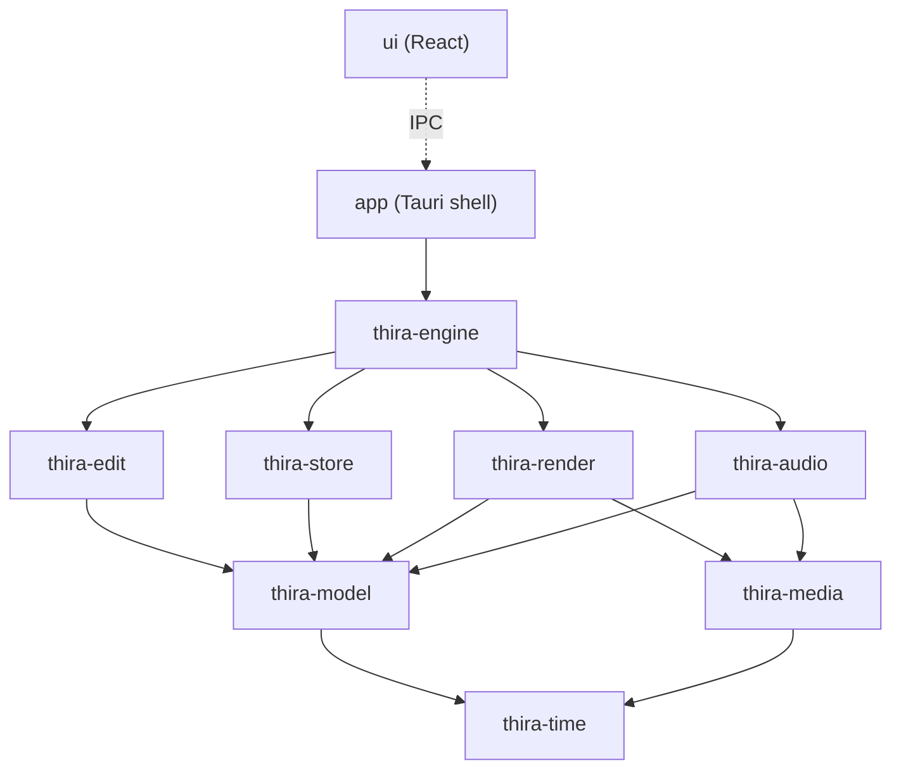

# 0001. Crate boundaries, threading model and engine-to-UI IPC

| | |
| --- | --- |
| Status | Accepted |
| Date | 2026-11-01 |
| Issue | #3 |

## Context

Thira is built by one maintainer with AI assistance (PRD G5), so modules must be small, testable on their own, and hard to couple by accident. The PRD also requires:

- every edit to be undoable and scriptable (G4, TL-6), so all edits go through one command bus;
- timeline operations and scrubbing to respond in under 100 ms (G1);
- the same behavior on Windows, macOS and Linux (G3);
- a Tauri + React UI over a Rust engine (PRD section 10).

This ADR fixes the crate layout, which threads own what, and how the UI talks to the engine. It does not decide how viewer frames reach the screen; that is [#2](https://github.com/SreeshanthT/thira/issues/2).

## Decision

### Repository layout

```text
crates/          Rust library crates (no Tauri dependency)
app/             Tauri application crate (thin shell)
ui/              React + TypeScript front end
docs/            PRD, roadmap, ADRs, user docs
```

### Crates

| Crate | Responsibility | Depends on |
| --- | --- | --- |
| `thira-time` | Rational time, frame rates, timecode (including drop-frame) | none |
| `thira-model` | Plain data types: project, timeline, track, clip, media reference. No behavior beyond validation | `thira-time` |
| `thira-edit` | Command bus, primitive commands (a serializable enum, each with an exact inverse), undo/redo history, edit operations (insert, trim, blade, …) built as transactions of primitives | `thira-model` |
| `thira-store` | SQLite persistence, schema migrations, atomic save, autosave | `thira-model` |
| `thira-media` | FFmpeg wrappers: probe, decode, encode; thumbnails and waveforms | `thira-time` |
| `thira-render` | wgpu device, render graph, GPU effects, frame cache | `thira-model`, `thira-media` |
| `thira-audio` | Audio mixing, resampling, device output | `thira-model`, `thira-media` |
| `thira-engine` | Session facade: owns the open project, runs the threads below, playback, background jobs, export | all of the above |
| `thira` (in `app/`) | Tauri shell: window, menus, IPC handlers that call `thira-engine` | `thira-engine` |



Rules:

1. Dependencies only point down the diagram. Cargo rejects cycles; code review enforces the direction.
2. Only `app/` depends on Tauri. Everything in `crates/` runs headless, so the engine can be tested, scripted and benchmarked without a window.
3. Only `thira-media` links FFmpeg. Only `thira-render` uses wgpu.
4. Library crates return typed errors (`thiserror`). `app/` converts them to user-facing messages.
5. All crates log through `tracing`.

### Threading model

| Thread | Owns | Notes |
| --- | --- | --- |
| Main (Tauri) | Windows, menus, IPC dispatch | Never blocks. Forwards requests to the engine thread |
| Engine | The open project and its undo history | Single writer: every command is applied here, in order. Publishes an immutable snapshot after each change |
| Render | wgpu device and queue, frame cache | Renders frames for a requested time from the latest snapshot |
| Decode workers | FFmpeg decoders, one pool shared by sources | Feed decoded frames to render and audio |
| Audio output | Device callback | Real time: no locks, no allocation; reads from a lock-free ring buffer |
| Job pool | Thumbnails, waveforms, proxies, export | Each job has a priority, progress reporting and a cancel token |

The model is shared by **snapshot, not by lock**: the engine thread owns the mutable project, and after each command it publishes an `Arc` of an immutable timeline snapshot. Render, audio and job threads read the latest snapshot and never block the engine. Snapshots use structural sharing, so an edit copies only the changed track, not the whole timeline.

### Engine-to-UI IPC

| Direction | Mechanism | Payload |
| --- | --- | --- |
| UI → engine | Tauri commands (`invoke`) | Typed requests, including edit commands as serializable DTOs |
| Engine → UI | Tauri events | `ModelChanged { version, changes }` with the IDs of changed objects; job progress; playback position |
| Thumbnails and waveforms | Custom URI scheme (`thira://`) | Binary data served from the on-disk cache, never JSON |
| Viewer frames | Decided in [#2](https://github.com/SreeshanthT/thira/issues/2) | Never JSON |

- The UI keeps a read-only mirror of the model. It is loaded in full when a project opens and then patched from `ModelChanged` events. The UI never mutates the mirror directly; it sends a command and waits for the change event.
- Every `ModelChanged` carries a monotonically increasing version, so the UI can detect a missed event and reload.
- TypeScript types for commands, DTOs and events are generated from Rust (via `specta`), so the two sides cannot drift.

## Alternatives considered

- **One large `thira-core` crate.** Simpler at first, but slower to compile, and nothing stops rendering code from reaching into storage. Rejected for G5.
- **Shared model behind a `RwLock`.** Simple, but long renders would block edits and edits would stall playback. Rejected for G1.
- **UI owns the model and the engine only renders.** Puts edit logic in TypeScript where it cannot be shared with scripting or tested with the engine. Rejected for G4.
- **Sending frames or thumbnails over JSON IPC.** Base64 encoding and parsing costs far exceed the 100 ms budget at 1080p. Rejected.

## Consequences

- Each crate can be developed and tested alone, matching small, issue-sized tasks.
- Headless engine tests cover editing, saving and rendering without a UI.
- Snapshots need a structurally shared timeline representation; this is a requirement on `thira-model` (#6).
- Generating TypeScript types adds a build step to the UI; CI must fail if generated types are out of date (#17).
- How the viewer is shown inside the window remains open until #2 is decided.
